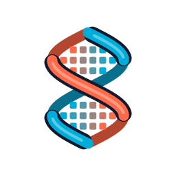

<div align="center">



<p>
  <b>Vanilla Minecraft: Bedrock Edition mob AI</b><br>
  Goals, pathfinding, movement, spawning and the entity packets
</p>

[-black)](https://feedback.minecraft.net/hc/en-us/sections/360001186971-Release-Changelogs)
[](https://go.dev/)
[](LICENSE)
[](STATUS.md)

</div>

## Why entity?

Custom Bedrock servers usually write mob AI that only looks like vanilla: mobs wander, chase and
spawn differently, and farms and contraptions that depend on vanilla behaviour break. entity aims to
be a one-to-one copy of how BDS runs mobs, while every goal, number and physics step stays
replaceable. It is part of [Helix](https://github.com/helix-bedrock), but it is its own engine: it
talks to the world only through small interfaces (`World`, `Mob`, `Navigator`), so any Go server can
use it.

## How it is checked

Everything comes from the decompiled Bedrock Dedicated Server (BDS) 1.26.52, and goals added or
changed since come from 1.26.60: the same rules, numbers and random draws in the same order, quirks
included. Each goal cites the BDS function addresses it was read from. The decompiled code is
**not** in this repo; it was only used to read how the game works.

## Quick Start

```shell
go get github.com/helix-bedrock/entity
```

```go
// w implements behavior.World; m implements behavior.Targeter for one of your mobs.
var goals goal.Selector
goals.Add(1, behavior.NewNearestAttackable(w, m, behavior.DefaultNearestAttackable))
goals.Add(6, behavior.NewStroll(w, m, behavior.DefaultStroll))
goals.Add(7, behavior.NewLookAt(w, m, behavior.DefaultLookAt))

goals.Tick(noAI) // every tick, from the mob's own tick
```

Each mob's goals run on that mob's tick, so mobs can be ticked on many threads.

## Packages

| Package | What it does |
|---|---|
| [`goal`](goal) | The goal selector |
| [`behavior`](behavior) | The vanilla goals (`minecraft:behavior.*`) |
| [`path`](path) | The pathfinder |
| [`nav`](nav) | The navigation components |
| [`move`](move) | The move controls |
| [`physics`](physics) | Mob movement and collision |
| [`definition`](definition) | Entity files: component groups, events, filters, properties |
| [`component`](component) | Builds a mob's goals, navigation, movement, sensors and state from its components |
| [`sensor`](sensor) | Timers, the scheduler and the sensors that fire a mob's events |
| [`state`](state) | A mob's own state components (age, breeding, taming, anger, riding, breathing and the rest) |
| [`spawn`](spawn) | The natural spawner (moving to Helix) |
| [`netsync`](netsync) | The entity packets, as BDS 1.26.60 sends them |

Items, inventories, players and spawning belong to the engine; entity reaches them through
interfaces.

## Roadmap

What works today, what is left and the state of every goal is in [STATUS.md](STATUS.md).

| Part | State |
|---|---|
| Goal selector, pathfinding, navigation | ✅ done |
| All 178 vanilla goals | 🟡 written from BDS; a few small gaps |
| Entity definitions (groups, events, filters, properties) | ✅ written from BDS 1.26.60 |
| Components, sensors and mob state | 🟡 every vanilla component read; some logic still from 1.21.3 |
| Physics | 🟡 done except water currents, bouncy blocks, vehicles, gliding |
| Entity packets | 🟡 written from BDS 1.26.60; a few fields left |
| Tested in game | ⬜ not yet |

**The goal is to match the latest Minecraft version exactly**, and to follow each Minecraft update.

## Contributing

- **Found a bug or a difference from vanilla?** Open an [issue](https://github.com/helix-bedrock/entity/issues)
- **Want to contribute code?** Read the [contributing guide](https://github.com/helix-bedrock/.github/blob/main/CONTRIBUTING.md)
  and the [AI policy](https://github.com/helix-bedrock/.github/blob/main/AI_POLICY.md)

## License

entity is licensed under [MIT](LICENSE). Mojang's vanilla data it reads lives in
[helix-data](https://github.com/helix-bedrock/helix-data).
